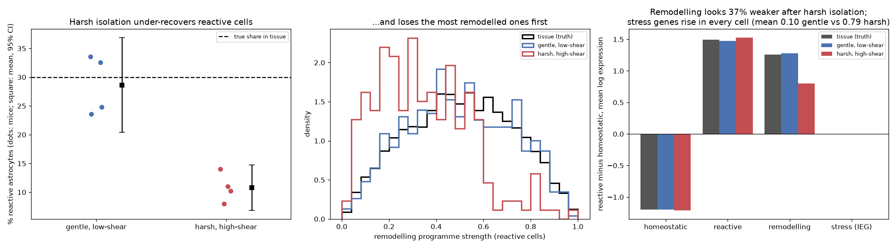

# Dissociation Recovery Bias

> Your single-cell atlas reports the cells that survived your protocol, not the cells that were in the tissue.

## Demo Output

Produced by `demo.py`. Simulated injured cortex: 30% of astrocytes are reactive, and the most remodelled reactive cells are the most fragile. Two isolation protocols, four mice each. Left: the reactive share recovered, per mouse. Middle: which reactive cells survive. Right: how the reactive-vs-homeostatic differences look afterwards.

## Why This Exists

Dostalova et al. (*Molecular Neurobiology* 2026) compared three dissociation workflows on mouse brain after stroke and in a tauopathy model. A widely used commercial protocol under-represented reactive astrocytes against an optimised low-shear protocol. It also selectively lost their morphological-remodelling signatures. Single-cell qPCR and spatial transcriptomics of intact tissue confirmed which protocol was closer to the truth.

The lesson applies well beyond astrocytes. **Isolation is a selection step.** This repo makes that visible: a cell's survival depends on how fragile it is, and fragility goes with the very biology you want to measure.

## How It Works

1. **Tissue.** Homeostatic and reactive astrocytes. Reactive cells carry a remodelling programme of varying strength, and their fragility grows with it.
2. **Isolation.** Each cell survives with probability `sigmoid(gentleness − harshness × fragility)`. Harsh protocols also switch on immediate-early "stress" genes in every survivor.
3. **Sequencing.** 500 captured cells per mouse, four mice per protocol.
4. **Analysis, done right.** Proportions are averaged *per mouse* with a t-based 95% CI, so the mouse is the replicate, not the cell. Signatures are compared with the tissue truth.

## What the Demo Shows

| Measure | Tissue | Gentle | Harsh |
|---------|--------|--------|-------|
| Reactive astrocytes | 29.6% | 28.7% (CI 20–37%) | **10.8%** (CI 7–15%) |
| Mean remodelling in reactive cells | 0.50 | 0.50 | **0.35** |
| Reactive − homeostatic, remodelling genes | 1.26 | 1.28 | **0.80** |
| Stress (IEG) score, all cells | 0.00 | 0.10 | **0.79** |

The harsh protocol does three things at once. It hides reactive cells, it makes the survivors look *less* reactive than they are, and it adds a stress programme that can be mistaken for activation.

## When NOT to Use This

- **As a correction tool.** You can recalibrate *composition* against an independent count from imaging, sc-qPCR or spatial data. But cells that died took their transcriptomes with them, and no reweighting brings back the lost remodelling signal.
- **With pooled libraries.** The paper pooled several mice per library. Then there is one data point per protocol, and no confidence interval is possible. Keep mice separate (or hash them) if you want to compare proportions.

## The Uncomfortable Truth

Every published single-cell composition is "composition × survival". If the cells you care about are large, branched, fibrotic or dying, assume they are under-counted until an orthogonal method says otherwise. Single-nucleus RNA-seq avoids some of this bias but has its own blind spots.

## Further Reading

- Dostalova D. et al. "Tissue Dissociation Workflows Influence Reactive Astrocyte Recovery in Single-Cell Transcriptomics." Molecular Neurobiology (2026). doi:10.1007/s12035-026-06278-w
- van den Brink S. C. et al. "Single-cell sequencing reveals dissociation-induced gene expression in tissue subpopulations." Nature Methods (2017).
- Denisenko E. et al. "Systematic assessment of tissue dissociation and storage biases in single-cell and single-nucleus RNA-seq workflows." Genome Biology (2020).
- Habib N. et al. "Disease-associated astrocytes in Alzheimer's disease and aging." Nature Neuroscience (2020).
